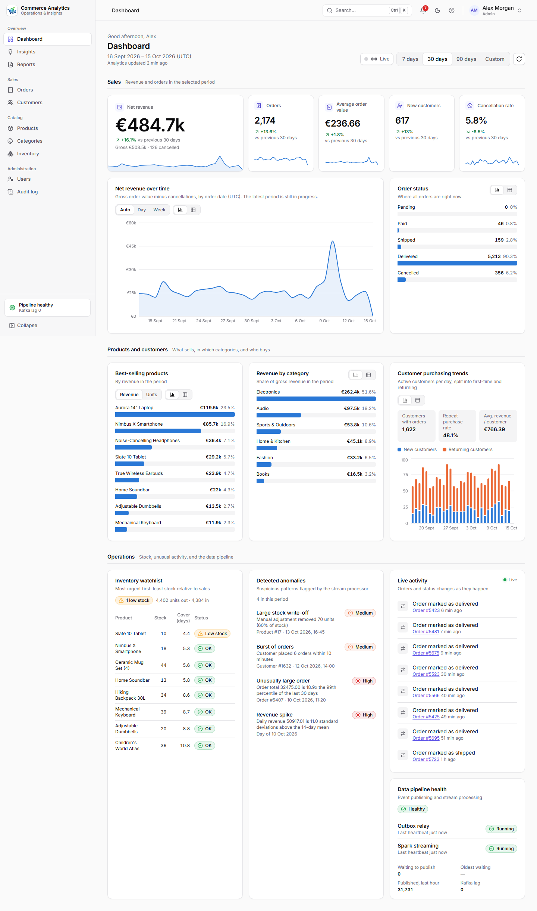
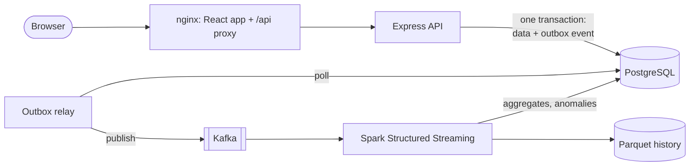

<p align="center"></p>

# Real-Time E-Commerce Analytics Platform

[](https://github.com/bijigunerachid/ecommerce-analytics-platform/actions/workflows/ci.yml)

An e-commerce operations app with a real-time analytics pipeline. Staff manage products,
customers, orders, and inventory in a React app. Every business change becomes an event that flows
through Kafka into Spark Structured Streaming, which keeps a Parquet history, maintains dashboard
metrics, and flags suspicious activity, all within seconds.



## Highlights

- **Correct by construction:** order totals are computed by the server in integer cents. Stock
  changes are transactional and can't go negative, even under concurrent orders. Retried requests
  are idempotent, so a double-click or network retry never creates a second order.
- **Transactional outbox:** events are written in the same database transaction as the change, so
  nothing is lost or invented when Kafka is down. They are published in order, at least once.
- **Exactly-once analytics:** Spark deduplicates by event id against PostgreSQL. Aggregates are
  exact even with redelivered events, replayed batches, or late data, and can be rebuilt from the
  Parquet history at any time.
- **Anomaly detection:** unusually large orders, order bursts from one customer, daily revenue
  spikes, and large stock write-offs. Thresholds were tuned on realistic data, from 122 false
  alarms down to 7 meaningful alerts.
- **Secure by default:** JWT in HttpOnly SameSite cookies, admin/analyst roles enforced on the
  server, validated input everywhere, parameterized SQL, login rate limiting, a strict
  Content-Security-Policy, and no secrets in the repository.
- **Accessible, responsive UI:** light and dark themes, keyboard-friendly dialogs, a table view
  for every chart, and validated colorblind-safe chart colors.
- **Tested at every layer:** about 350 automated tests (backend against real PostgreSQL and Kafka,
  Spark jobs, frontend), plus a full-stack smoke test, all in CI.

## Quick start (Docker only)

You need **Docker Desktop** with about 4 GB of memory for Docker. Nothing else has to be installed.
Commands are for PowerShell, from the repository folder.

**1. Configure.** Copy the example settings, then generate two secrets:

```powershell
Copy-Item .env.example .env
# Run this twice: once for POSTGRES_PASSWORD, once for JWT_SECRET
$b = New-Object byte[] 32; [Security.Cryptography.RandomNumberGenerator]::Create().GetBytes($b); -join ($b | ForEach-Object { $_.ToString('x2') })
```

Paste the values into `.env` (replace `change-me-…`) using VS Code or Notepad. `.env` is
git-ignored. Never commit it.

**2. Start everything:**

```powershell
docker compose up -d --build --wait
```

The first run builds the images and takes several minutes; later starts take under a minute. This
starts PostgreSQL, Kafka, the database migrations, the API, the outbox relay, the Spark streaming
job, and the web app.

**3. Create the first administrator** (there is no public sign-up):

```powershell
docker compose exec api node scripts/create-admin.js
```

**4. Open <http://localhost:8080>** and sign in.

**Optional: load 90 days of realistic sample data** (only into an empty database, about 2
minutes). The dashboard fills within a minute as the events stream through the pipeline:

```powershell
docker compose exec api node scripts/generate-sample-data.js
```

| Task | Command |
| --- | --- |
| Status of all services | `docker compose ps` |
| Logs of one service | `docker compose logs -f api` (or `relay`, `spark-streaming`, `web`) |
| Stop (keep data) | `docker compose down` |
| Stop and **delete all data** | `docker compose down -v` |
| Spark UI | <http://localhost:4040> |
| Smoke and browser tests | `node scripts/test-stack.mjs` (a separate throwaway stack on port 8081; see [e2e/README.md](e2e/README.md)) |

Something not working? See [docs/troubleshooting.md](docs/troubleshooting.md).

## Features

| Area | What you can do |
| --- | --- |
| Dashboard | KPIs vs the previous period with trend lines; revenue over time; best sellers and categories; order status; new vs returning customers; inventory watchlist; anomalies; pipeline health; live activity feed and a "Live" auto-refresh |
| Insights | 14-day sales forecast with an 80% range and backtest accuracy; customer segments (RFM) with their customers; weekly repeat-purchase cohorts (computed by Spark) |
| Reports | Printable sales report for any period; CSV / Excel exports of every list with the filters on screen |
| Orders | Search, filter, bulk status changes; place orders with pickers; lifecycle with a progress tracker, status history with notes, staff notes, printable invoices |
| Catalog | Products and categories; product pages with daily sales, stock history from the ledger, days of stock left, and one-click restock |
| Customers | Customer pages with lifetime value, segment, monthly spend, most-bought products, and orders |
| Inventory | Full stock ledger (orders, cancellations, restocks, adjustments) and idempotent adjustments |
| Notifications | Bell with low-stock, out-of-stock, and anomaly alerts, pushed live (Server-Sent Events) |
| Account and security | Profile and password change, sign out other sessions, user administration with last-admin protection, append-only audit log |
| Productivity | Command palette (Ctrl+K) to find pages and records, keyboard shortcuts, light/dark themes |
| Developer and operations | OpenAPI document and Swagger UI at `/api/docs`, Prometheus metrics, optional Prometheus + Grafana dashboard |

More screenshots (dark mode, mobile, orders, inventory, forms) are in
[docs/frontend.md](docs/frontend.md).

## Architecture



PostgreSQL is the system of record; Kafka and Spark only ever see copies of events. The full
design, with a sequence diagram of an order and the list of guarantees, is in
[docs/architecture.md](docs/architecture.md).

## Tech stack

| Layer | Technologies |
| --- | --- |
| Frontend | React 19, Vite 7, Tailwind CSS v4, React Router 7, Recharts 3, lucide icons (JavaScript only) |
| Backend | Node.js 22, Express 5, Zod 4, PostgreSQL 17 (`pg`), JWT + bcrypt, node-pg-migrate |
| Streaming | Apache Kafka 4.2 (KRaft), Confluent Kafka client (librdkafka) |
| Analytics | Apache Spark 4.1 Structured Streaming (PySpark), Parquet, psycopg 3 |
| Infrastructure | Docker Compose, nginx, GitHub Actions, Prometheus, Grafana |
| Testing | Vitest, Supertest, Testing Library, MSW, pytest, Playwright with axe-core (end-to-end and accessibility) |

## Repository layout

| Path | Contents |
| --- | --- |
| `frontend/` | React app; `Dockerfile` builds it into an nginx image |
| `backend/` | Express API, outbox relay, migrations, scripts (admin, sample data) |
| `analytics/` | PySpark streaming and batch jobs, with tests |
| `data/samples/` | Synthetic product catalog for the sample data generator |
| `docs/` | Architecture, API, events, database, analytics, frontend, development, troubleshooting |
| `scripts/` | Environment check and full-stack smoke test |
| `e2e/` | Playwright browser end-to-end and accessibility tests |
| `observability/` | Prometheus scrape config and the provisioned Grafana dashboard |
| `.github/workflows/` | CI |

## Documentation

| Document | Contents |
| --- | --- |
| [docs/architecture.md](docs/architecture.md) | Components, order flow, guarantees, observability |
| [docs/development.md](docs/development.md) | Running the code locally with hot reload; all test commands |
| [docs/api.md](docs/api.md) | Every REST endpoint, errors, roles, idempotency |
| [docs/events.md](docs/events.md) | Kafka topics, event contracts, delivery guarantees |
| [docs/database.md](docs/database.md) | Schema, constraints, locking |
| [docs/analytics.md](docs/analytics.md) | Spark pipeline, exactly-once design, anomaly rules, recovery |
| [docs/frontend.md](docs/frontend.md) | Frontend structure, design system, accessibility, screenshots |
| [docs/troubleshooting.md](docs/troubleshooting.md) | Common problems and fixes |
| [CONTRIBUTING.md](CONTRIBUTING.md) | Branching, commit conventions, CI |

## Testing

| Suite | Command | Runs in CI |
| --- | --- | --- |
| Backend (API, database, Kafka relay) | `cd backend; npm test` | ✓ with PostgreSQL and Kafka services |
| Analytics (Spark jobs) | `docker compose run --rm analytics-tests` | ✓ inside the Spark image |
| Frontend (components, pages, flows) | `cd frontend; npm test` | ✓ plus a production build |
| Full stack (through nginx) | `node scripts/test-stack.mjs smoke` | ✓ on a fresh, separate test stack |
| Browser end-to-end and accessibility | `node scripts/test-stack.mjs e2e` | ✓ on the same test stack |

Details and single-test commands are in [docs/development.md](docs/development.md).

## Data and privacy

All data in this repository is synthetic: the product catalog is fictional and generated customers
use `@example.com` addresses. No real customer or payment information is used or stored.
