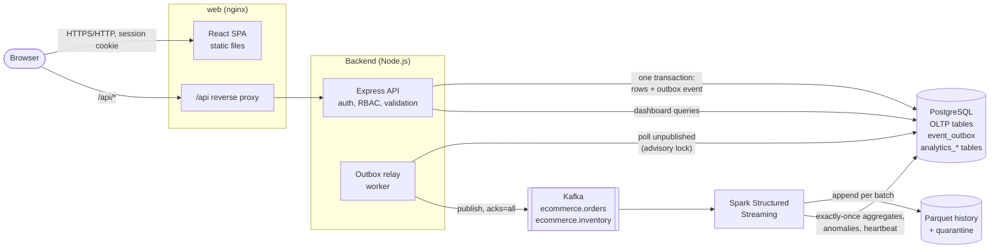
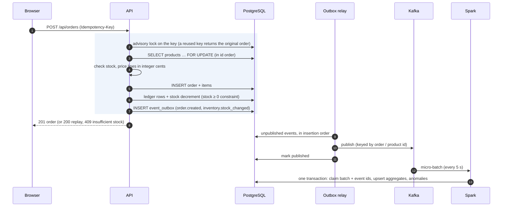
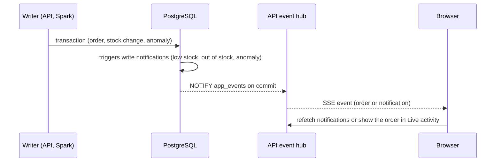

# Architecture

The platform has two halves that share one PostgreSQL database but never mix responsibilities:

- The **transactional side** (React, Express, PostgreSQL) is the system of record. Orders and stock
  changes are validated and committed in database transactions.
- The **analytical side** (outbox relay, Kafka, Spark) consumes copies of business events and
  produces derived data: Parquet history and dashboard aggregates.

Kafka and Spark never hold transactional state. If they are down, the store keeps working and the
analytics catch up later.

## Components

| Container | Image | Role |
| --- | --- | --- |
| `web` | `frontend/Dockerfile` (nginx 1.30) | Serves the built SPA; proxies `/api` to the API; security headers (CSP) |
| `api` | `backend/Dockerfile` (Node 22) | REST API: auth, orders, inventory, analytics endpoints |
| `relay` | same image as `api` | Publishes `event_outbox` rows to Kafka |
| `migrate` | same image as `api` | One-shot: applies database migrations before anything else starts |
| `postgres` | `postgres:17-alpine` | System of record, outbox, analytics tables |
| `kafka` | `apache/kafka:4.2.1` (KRaft) | Event log between the backend and Spark |
| `spark-streaming` | `analytics/Dockerfile` (Spark 4.1.3) | Validates, deduplicates, aggregates, detects anomalies |

Only `web` (8080), PostgreSQL (5432), Kafka (9092), and the Spark UI (4040) are published, and only
on `127.0.0.1`. The API is reachable only through nginx.

## Placing an order

Everything inside the box is one PostgreSQL transaction: either all of it is committed, or none of
it is.

## Live updates and notifications

The browser keeps one Server-Sent Events connection (`GET /api/stream`) open per signed-in tab.
Updates come from PostgreSQL itself, so they follow committed data whoever wrote it:

- **Triggers** create notifications in the same transaction as the change: stock crossing its
  reorder level, stock reaching zero, and every anomaly Spark records (deduplicated, so the
  analytics rebuild does not notify twice).
- **Event hub** (`src/realtime/event-hub.js`): one dedicated connection runs `LISTEN app_events`
  and fans out to the open streams. It reconnects with backoff; streams then get a `resync`
  event, and the browser refetches what it shows.
- **Streams** send a heartbeat every 25 s that also re-checks the session, so an expired token or
  a deactivated account ends the stream. nginx serves `/api/stream` without buffering.
- Live updates are a convenience: everything they show is also available from the regular
  endpoints, and a missed event never leaves the data wrong.

## Guarantees

| Concern | How it is handled |
| --- | --- |
| Overselling | Product rows are locked (`FOR UPDATE`) before the stock check, and a `CHECK (stock_quantity >= 0)` constraint is the final safety net |
| Retried order requests | `Idempotency-Key`: an advisory lock serializes same-key requests; a replay returns the original order; a different body with the same key is `409` |
| Deadlocks between orders | Rows are always locked in ascending product id order |
| Events vs. data | The outbox row commits in the same transaction as the change: an event exists if and only if the change happened |
| Kafka outage | Events wait in `event_outbox`; the relay retries with backoff and publishes in order once Kafka is back |
| Duplicate delivery | At-least-once publishing; Spark deduplicates by `event_id` against `analytics_processed_events` |
| Spark crash or replay | Offsets in the checkpoint; batch ids recorded in PostgreSQL; Parquet written per batch with overwrite |
| Lost or wrong aggregates | `spark-rebuild` recomputes everything from the Parquet history |
| Session security | JWT in an HttpOnly, SameSite=Strict cookie; user, role, and session version reloaded from the database on every request, so deactivation, password changes, and "sign out other sessions" take effect immediately |
| Lockout | Admins cannot demote or deactivate themselves, and the last active admin cannot be removed (row locks make concurrent changes safe) |
| Accountability | Every sign-in (including failed ones) and every change is written to an append-only `audit_log` with the actor and client IP |
| Spoofed client IPs | The API trusts `X-Forwarded-For` only from the configured number of proxies (`TRUST_PROXY`) |

More detail: [database.md](database.md) (schema and locking), [events.md](events.md) (event
contracts and delivery), [analytics.md](analytics.md) (Spark pipeline), [api.md](api.md)
(endpoints), [frontend.md](frontend.md) (UI).

## Health and observability

- `GET /api/health`: API and database (`/api/health/live` for the process only)
- `GET /api/pipeline/health`: outbox backlog, oldest pending event, failures, relay and Spark
  heartbeats, Kafka consumer lag. Shown on the dashboard.
- Docker health checks: the API over HTTP; the relay and Spark from their heartbeats in
  PostgreSQL, so a stalled worker shows as `unhealthy` in `docker compose ps`.
- Spark UI at <http://localhost:4040>.
