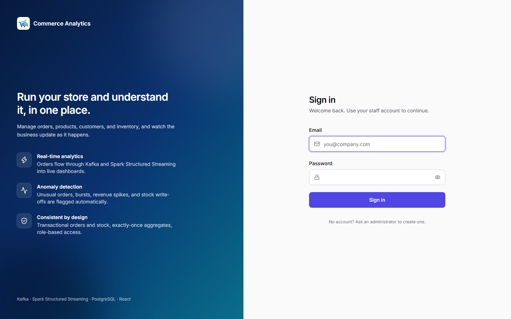
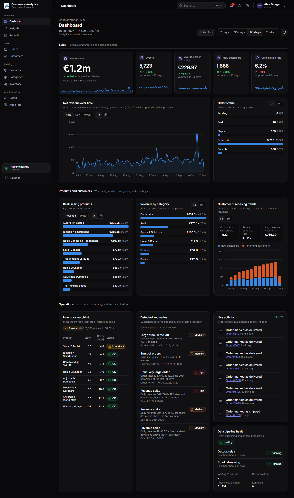
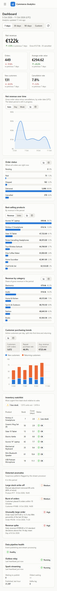
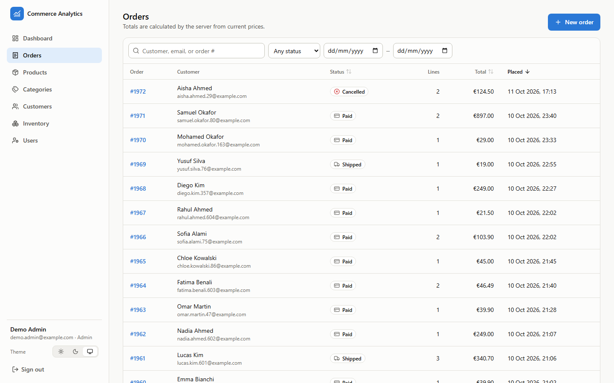
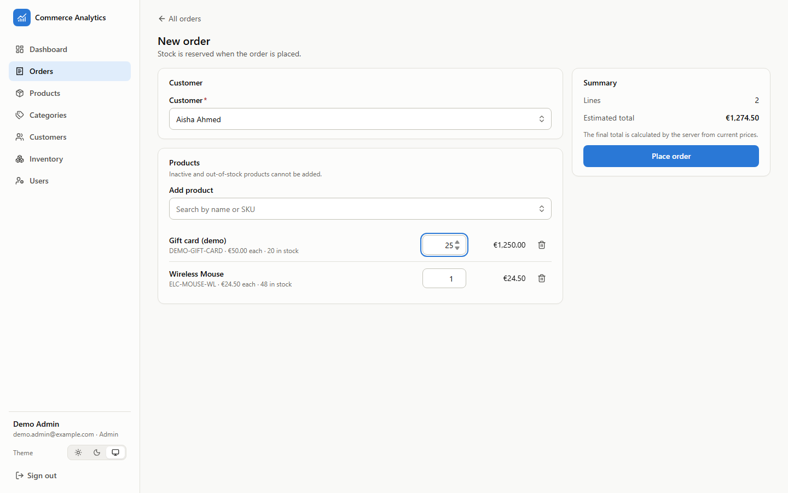
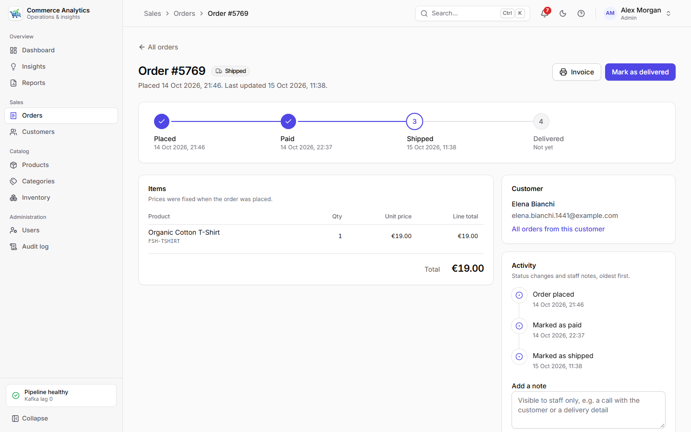
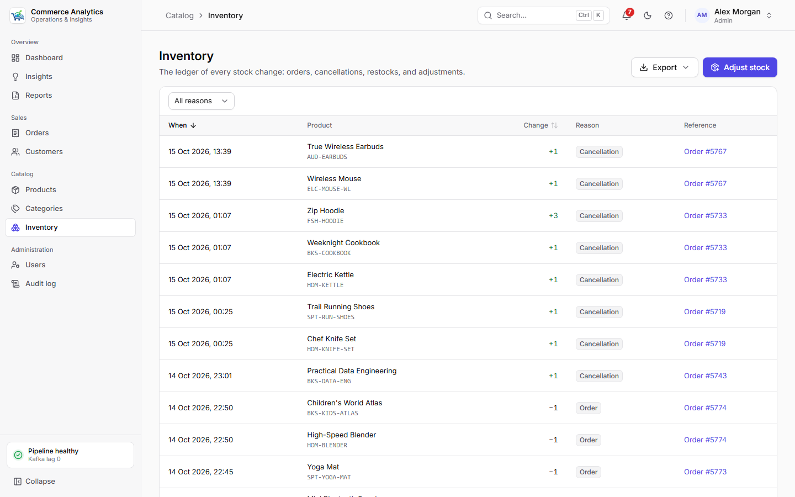
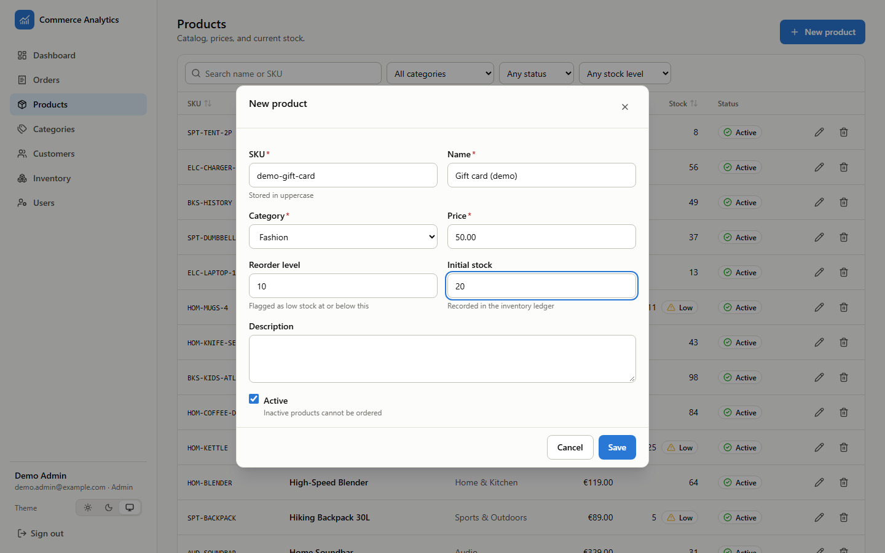

# Frontend

React 19 single-page app in plain JavaScript (no TypeScript), built with Vite 7 and styled with
Tailwind CSS v4. Routing uses React Router 7, charts use Recharts 3, and icons come from
lucide-react.


## Running

```powershell
cd frontend
npm install
npm run dev          # http://localhost:5173
```

The API must be running (`npm run dev` in `backend/`). The Vite dev server **proxies `/api` to the
backend** (port from `API_PORT` in the root `.env`, default 4000; override with
`VITE_API_PROXY_TARGET`). Because the browser only ever talks to its own origin, the HttpOnly,
`SameSite=Strict` session cookie works without any CORS setup.

| Command | What it does |
| --- | --- |
| `npm run dev` | Dev server with hot reload |
| `npm test` | Vitest + Testing Library (jsdom), API mocked with MSW |
| `npm run build` | Production build into `dist/` |
| `npm run preview` | Serve the production build (also proxies `/api`) |
| `npm run lint` / `npm run format:check` | ESLint (incl. React Hooks rules) / Prettier |

## Pages

| Page | Who | What |
| --- | --- | --- |
| Dashboard `/` | everyone | KPIs, charts, inventory watchlist, anomalies, pipeline health |
| Orders `/orders` | everyone | Search by customer, email or order number; filter by status, dates, customer |
| Order `/orders/:id` | everyone; admins change status | Line items and totals. Only the allowed next statuses are offered; cancelling (which restocks) asks for confirmation |
| New order `/orders/new` | admin | Search-as-you-type customer and product pickers, quantities, live estimate |
| Products `/products` | everyone; admins edit | Search name/SKU; filter by category, status, low stock; create, edit, delete |
| Categories `/categories` | everyone; admins edit | Product counts; create, edit, delete |
| Customers `/customers` | everyone; admins edit | Order count and total spent; link to their orders |
| Inventory `/inventory` | everyone; admins adjust | The stock ledger with links to orders; restock and adjustment form |
| Users `/users` | admin | Staff accounts; create admins and analysts |

Admin-only controls are hidden from analysts and admin-only routes redirect them. This is for
clarity only: the API enforces every permission.

### Forms and errors

- **Two layers of validation:** client-side checks mirror the API's rules for instant feedback,
  and the API's `VALIDATION_ERROR` details are mapped back onto the matching fields.
- **Conflicts** (duplicate SKU or email, deleting something still in use) appear in a banner
  inside the form or confirmation dialog, which stays open so nothing is lost.
- **Successful actions** show a short notification.

### Idempotent orders and adjustments

New orders and stock adjustments send an `Idempotency-Key` header:

- The key is created when the form opens and kept for retries. If a request fails with a network
  error, the order may or may not have been placed. Pressing the button again with the same data
  is safe, because the server returns the original order instead of creating a second one or
  deducting stock twice.
- Changing the order (customer, products, quantities) creates a new key, since it is a different
  request.
- If stock runs out, the API's `INSUFFICIENT_STOCK` details highlight each affected line with
  the quantity still available.

## Structure

```
src/
  api/          fetch wrapper (cookies, errors → ApiError, 401 → session expired) and endpoints
  auth/         AuthProvider (session restore via /auth/me), RequireAuth route guard
  theme/        ThemeProvider: light / dark / system, saved per browser
  hooks/        useApiQuery (fetch state, abort, keep data while refetching), useListParams and
                useDateRange (list/range state in the URL), useForm (values, errors, submit)
  components/   ui/ (buttons, fields, modal, toasts, badges), charts/, and data/ (sortable
                paginated ResourceTable, EntityPicker combobox)
  features/     dashboard panels (each fetching its own data), command palette and keyboard
                shortcuts, sidebar pipeline status
  layouts/      app shell (grouped sidebar, top bar, drawer on mobile) and navigation.js, the
                one list of sections used by the sidebar, breadcrumbs, palette, and shortcuts
  pages/        Login, Dashboard (lazy-loaded), Orders, Order, New order, Products,
                Categories, Customers, Inventory, Users, Not found
  routes.jsx    route table (used by the app and by tests)
```

- **Auth:** the session token lives in an HttpOnly cookie, so JavaScript can't read it. On load
  the app asks `/api/auth/me` who is signed in. Any 401 afterwards clears the session and routes
  back to `/login`, returning to the original page after sign-in. Route guards are a UI
  convenience; the API enforces authentication and roles itself.
- **Data fetching:** each dashboard panel loads independently, so one failing endpoint shows an
  error with a retry button in its own card while the rest of the dashboard works. Refetches keep
  the previous data on screen instead of flashing loading skeletons.
- **Date range:** stored in the URL (`?range=30d` or `?from=…&to=…`), so views can be bookmarked
  and shared. It applies to every panel. Dates are UTC, matching the API.
- **Code splitting:** the dashboard and charting library load lazily, so the sign-in page stays
  light.

## Orders

- **Order page:** a progress tracker (placed → paid → shipped → delivered, with the time each
  step was reached; cancelled orders end in a cancelled step), the items, the customer, and an
  activity feed that merges status changes and staff notes. Admins change the status from the
  page header (with an optional note saved in the history) and add notes.
- **Invoice:** `/orders/:id/invoice` renders a printable invoice without the app shell (Print or
  save as PDF from the browser; the palette is always light on paper). It shows only what the
  system records: no tax lines. A cancelled order's invoice is marked void. The seller name comes
  from `VITE_STORE_NAME`.
- **Bulk status changes:** admins select rows on the Orders list (one row, or the whole page
  with the header checkbox) and apply a status to all of them. Orders that could not change are
  listed with the reason. The selection clears when the page or a filter changes.

## Customer and product pages

- **Customer** (`/customers/:id`, linked from the customer list and search): contact details,
  segment, lifetime value, orders (with cancellations), average order, last order, spend per
  month for 12 months (bars, with a table view), most-bought products, and their orders.
- **Product** (`/products/:id`): units sold per day and stock at the end of each day (two
  separate charts, never two y-axes; the reorder level is a dashed reference line), with a
  30/90/180-day period kept in the URL. A stock panel shows days of stock left and the restock
  suggestion; admins restock the suggested quantity in one click (the regular, idempotent
  stock adjustment). Below, every stock movement of the product.

## App shell and navigation

- **Sidebar:** sections grouped as Overview, Sales, Catalog, and Administration (admins only).
  On large screens it collapses to an icon rail (remembered per browser); below 1024px it is a
  drawer. Its footer shows live pipeline status (relay + Spark, Kafka lag), polled every 30 s.
- **Top bar:** breadcrumbs, search, a light/dark toggle, the shortcut list, and the account menu
  (name, role, theme choice, sign out). The menu follows the WAI-ARIA menu button pattern
  (arrow keys, Home/End, Escape returns focus to the button).
- **Command palette** (`Ctrl`/`⌘` + `K`, or `/`): jump to any page, run quick actions (new
  order, theme), and search orders, products, and customers through the list APIs (5 results
  each, debounced). It is a combobox with a listbox (`aria-activedescendant`), so screen readers
  announce the highlighted result while focus stays in the input. Results open the matching list
  filtered by `?search=`; the list's search box follows the URL.
- **Keyboard shortcuts:** `g` then a page key (`d` dashboard, `o` orders, `c` customers,
  `p` products, `t` categories, `i` inventory, `u` users) and `?` for the list. Single-key
  shortcuts are ignored while typing and while a dialog is open.
- **Dashboard live mode:** the *Live* toggle refreshes every panel every 15 s (remembered per
  browser). Refetches keep the current data on screen, so nothing flashes.

## Visual design and accessibility

- **Typography:** Inter (variable), self-hosted through `@fontsource-variable/inter` and bundled
  by Vite, because the Content-Security-Policy allows fonts only from the app's own origin.
- **Loading:** first loads show skeleton placeholders shaped like the content (table rows, panel
  blocks); the shimmer stops under `prefers-reduced-motion`.
- **KPI tiles** carry a small trend line of the daily series from `/api/analytics/revenue`
  (decorative and hidden from screen readers; the figure and its change are stated in text).
- **Tokens:** colors are CSS variables in `src/index.css`, mapped to Tailwind utilities
  (`bg-surface`, `text-ink-secondary`, …). Dark mode redefines the same tokens under `.dark`, and
  the saved theme is applied before first paint, so there is no light flash.
- **Charts** follow a validated reference palette:
  - Categorical series colors (blue, orange) were checked with a color-vision-deficiency
    validator in both themes.
  - Status colors (good / warning / serious / critical) are separate and always paired with an
    icon and a label.
  - Text never takes a series color.
- **Chart forms** match the data's job:
  - The single headline number (net revenue) is a hero figure.
  - Trends over time are a 2px line with a light area wash.
  - Rankings (products, categories, statuses) are labeled horizontal bars with the value at the
    tip.
  - New vs returning customers is a two-series stacked column with a legend.
  - No chart uses two y-axes.
- **Every chart has a table view** (the chart/table toggle), so values are readable without
  hovering and without relying on color.
- **Dialogs:** labelled, focus moves to the first field, Tab stays inside, Escape closes, and
  focus returns to the button that opened them. The pickers follow the combobox pattern
  (arrow keys, Enter, Escape).
- **Tables:** sortable headers announce their state with `aria-sort`; on small screens a table
  scrolls inside its card instead of widening the page.
- **Interaction and semantics:**
  - Keyboard focus is visible, and there is a skip link.
  - Icon-only buttons have accessible names.
  - Form errors are linked with `aria-describedby`.
  - Status changes are announced with `role="alert"`.
- **Responsive:** single column on phones (no horizontal scroll at 390px), sidebar drawer below
  1024px.

## Configuration

| Variable | Default | Purpose |
| --- | --- | --- |
| `VITE_API_URL` | `/api` | API base URL baked into the build. Keep `/api` when the API is served from the same origin (dev proxy or a reverse proxy). |
| `VITE_API_PROXY_TARGET` | `http://localhost:${API_PORT}` | Where the dev/preview server forwards `/api` |
| `VITE_CURRENCY` | `EUR` | Currency used to display money values |
| `VITE_STORE_NAME` | `Commerce Analytics` | Seller name printed on invoices |

## Screenshots

| | |
| --- | --- |
|  |  |
|  |  |
|  |  |
|  |  |

The dashboard screenshots show the 90-day synthetic dataset (`npm run generate-data`) processed through the
full pipeline (relay → Kafka → Spark). They were captured with a headless browser.
